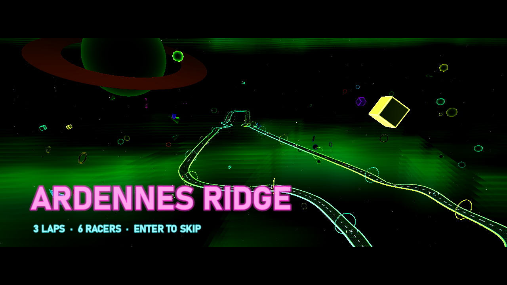
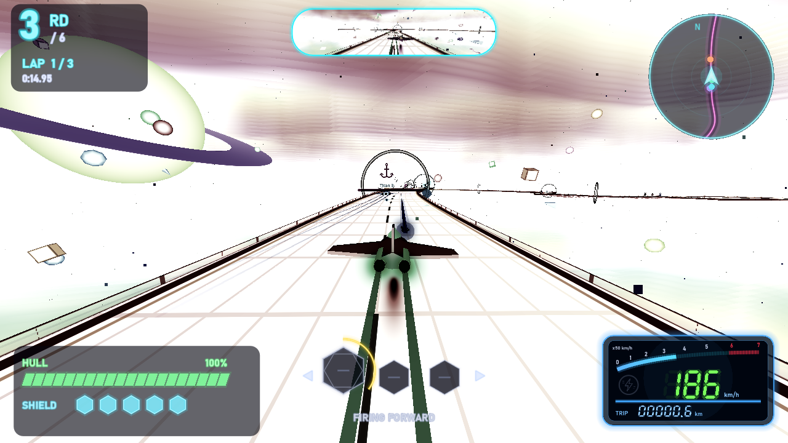
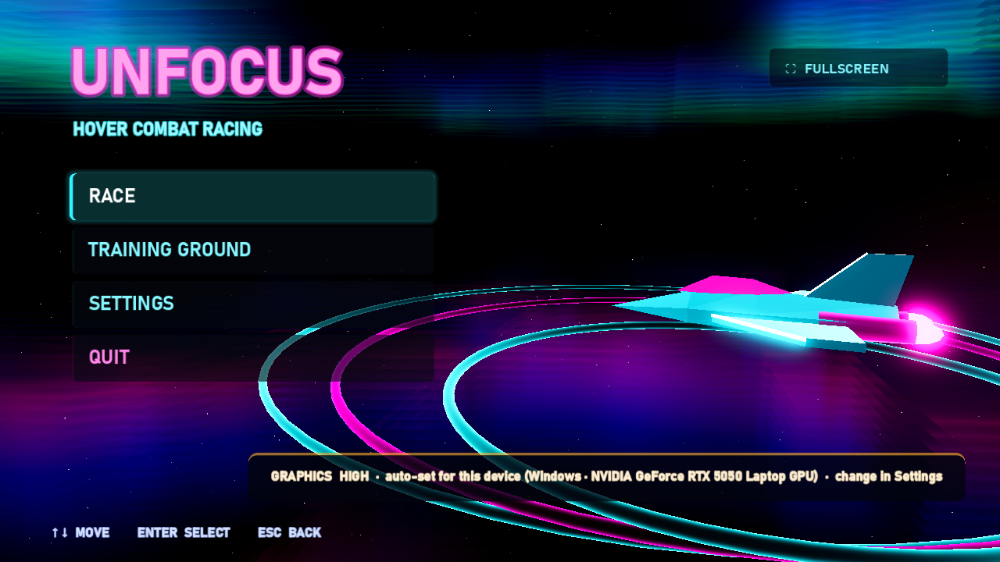

# UNFOCUS — Hover Combat Racing

**Neon anti-gravity jets, floating circuits in a pitch-black void, and a full arsenal of combat abilities.**
Made with [Godot 4.7](https://godotengine.org) · runs on desktop and **in your browser**.

### ▶ [Play in your browser](https://smil-is-vibe-coding.github.io/Unfocus/)


---

## What is it?

UNFOCUS is an arcade combat racer in the spirit of classic Blur-style racers and anti-gravity racing games:
hover jets race around neon circuits floating in deep space, under drifting aurora curtains.
Leave the road and you fall into the void — unless your energy shield catches you.

<p>
  
  
</p>

## Features

- **5 jet classes**: Viper, Dart, Manta, Titan, Wraith. Each has its own shape, handling, armour and a unique perk, with clear pros and cons.
- **5 circuits inspired by famous Grand Prix tracks**, each with its own colour vibe:

  | Circuit | Inspired by | Vibe |
  |---|---|---|
  | Autodromo Neon | the Italian "temple of speed" | rainbow neon |
  | Airfield Flow | the British airfield classic | synthwave sunset |
  | Ardennes Ridge | the legendary Belgian forest track (Eau Rouge!) | acid green |
  | Crossover 8 | the famous Japanese figure-eight with its bridge | glacier blue |
  | Harbour Negative | the glamorous harbour street race | photographic negative: white void, black jets |

- **7 abilities, 3 inventory slots**: boost, machine gun, invisibility, venom hookshot, homing missile, repair and forcefield. The gun, missile and hookshot can be fired **forward or backward**.
- **Hover physics**: four repulsor rays per jet, drifting with the airbrake, drift boosts, banking and a track magnet over crests.
- **Edge force field**: a hexagonal shield lights up when you hit the road edge. It saves you 5 times, then you can fall.
- **Asphalt-style intro**: a circuit flyover, rival close-ups on 3-2-1, then a swoop into the cockpit view. **Launch control** rewards a perfect start and floods your engine if you jump it.
- **Light-speed boost**: neon warp streaks, a radial blur and an FOV punch.
- **Neon HUD**: a digital LCD speedometer, a rotating radar minimap, a rear-view mirror, race position, laps and a hull/shield bar.
- **Training Ground**: test every ability on target dummies.
- **Touch controls** for phones and tablets, a **fullscreen** button, and **auto graphics presets** (LOW / MEDIUM / HIGH) chosen per device.
- **100% original audio**: every engine, weapon, UI sound and both music tracks are synthesised from code (`tools/generate_audio.py`). No samples, so it's royalty-free.

<p>
  
  
</p>
<p>
  
</p>
<p>
  
  
</p>

## Controls

| Action | Keyboard | Gamepad | Touch |
|---|---|---|---|
| Thrust / brake | W / S | RT / LT | THRUST / BRAKE |
| Steer | A / D | Left stick | Left-side joystick |
| Airbrake (drift) | Space | A | DRIFT |
| Select ability slot | ← / → | D-pad ← / → | ◀ ▶ |
| Use ability / fire forward | ↑ (or E) | RB | ▲ |
| Fire backward (gun, missile, hook) | ↓ (or Q) | LB | ▼ |
| Look back | C | Right-stick click | ◎ |
| Reset onto the track | R | Y | — |
| Pause | Esc | B | II |
| Fullscreen | F11 | — | menu button |

**Tip:** tap the throttle exactly on **GO** for a perfect launch boost. Holding it during the countdown floods the engine.

## Download (desktop, best performance)

The desktop builds use Godot's full **Forward+** renderer and run much faster and prettier than the browser version.

| Platform | File | Notes |
|---|---|---|
| **Windows** (64-bit) | `Unfocus.exe` | Single self-contained file. On dual-GPU laptops it requests the dedicated NVIDIA/AMD GPU automatically. Windows SmartScreen may warn because it isn't code-signed: click **More info → Run anyway**. |
| **macOS** (Intel + Apple Silicon) | `Unfocus.zip` → `Unfocus.app` | Not notarized by Apple. On first launch, **right-click → Open**, or run `xattr -cr Unfocus.app` in Terminal. |

Grab them from the repository's **[Releases](https://github.com/smil-is-vibe-coding/Unfocus/releases)** page.

## Run it locally

1. Install **Godot 4.7.2** (standard build).
2. Open `project.godot` and press **F5**.

## Build desktop versions

```powershell
# Windows .exe  -> build/windows/Unfocus.exe
Godot_v4.7.2-stable_win64_console.exe --headless --path . --export-release "Windows Desktop" build/windows/Unfocus.exe
# macOS universal app (can be built from Windows) -> build/macos/Unfocus.zip
Godot_v4.7.2-stable_win64_console.exe --headless --path . --export-release "macOS" build/macos/Unfocus.zip
```
(Needs the Godot 4.7.2 export templates. The macOS build is ad-hoc signed; notarization requires an Apple Developer account.)

## Build for the web

The project includes a **Web** export preset (no-threads build, so it works on any static host such as GitHub Pages or itch.io).

```powershell
# needs the Godot 4.7.2 export templates (Editor > Manage Export Templates)
powershell -ExecutionPolicy Bypass -File tools/export_web.ps1          # -> build/web/
powershell -ExecutionPolicy Bypass -File tools/export_web.ps1 -Serve   # build + open http://localhost:8000
```

Or use the editor: **Project → Export… → Web → Export Project**.
Upload the contents of `build/web/` to any static host. It has to be served over http(s), because browsers block WebAssembly loaded from `file://`.
The live version is deployed from the **`gh-pages`** branch.

## Project layout

```
scenes/            main_menu, menu (hangar), main (race), training
scripts/jets/      HoverJet physics, jet specs + catalog, procedural jet models
scripts/items/     abilities, missile, pickups, neon effects
scripts/track/     procedural floating track, force field, space scenery
scripts/levels/    circuit + theme definitions
scripts/ui/        neon HUD widgets, menus, touch controls, mirror
scripts/fx/        cinematic intro, venom hookshot, light-speed warp
shaders/           sky/aurora, road, barrier, force field, warp, negative, ...
audio/             synthesised sound + music (generated)
tools/             generate_audio.py, circuit_designer.py, export_web.ps1
```

## Roadmap

- [ ] **Multiplayer**: online races and battles
- [ ] **More circuits**, including new real-world-inspired layouts and fantasy tracks
- [ ] **More jets**, with new classes and perks
- [ ] Ghost replays and time trials
- [ ] Unlockable jet skins

## Credits

- Game design and direction: **smil-is-vibe-coding**
- Built with **AI pair-programming assistance from Claude (Anthropic)**, which helped write the code, shaders, procedural audio, circuits and docs.
- Engine: [Godot Engine](https://godotengine.org) (MIT).
- Circuit layouts are original designs *inspired by* well-known racing circuits. This is a fan-made game and is not affiliated with any circuit, series or brand.
