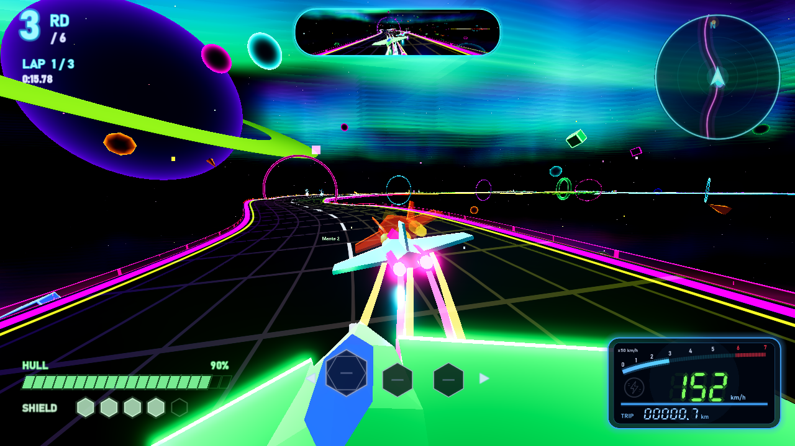
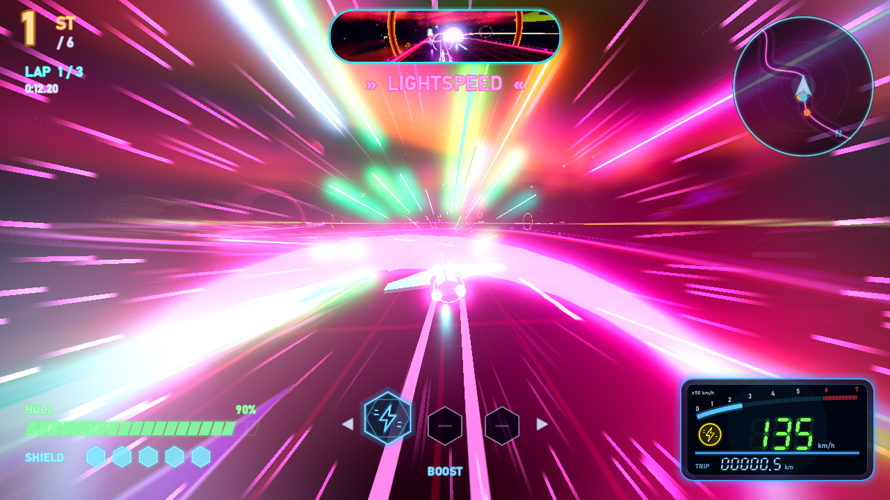
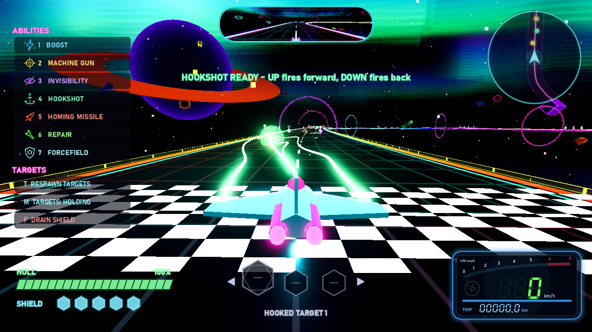
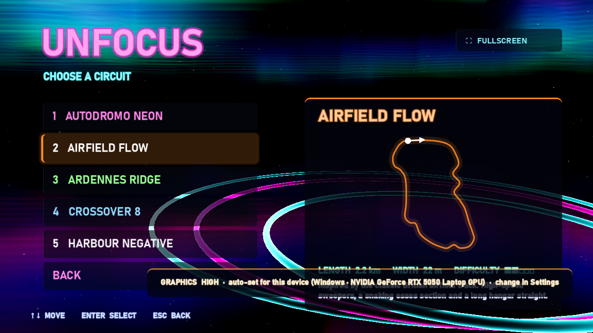
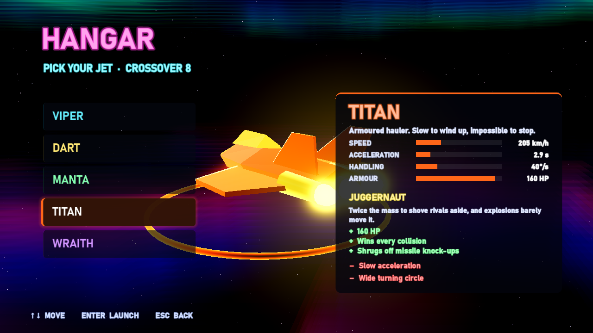

<div align="center">

# UNFOCUS

### Neon hover combat racing

**Anti-gravity jets, floating circuits in a pitch-black void, and a full arsenal of combat abilities.**

[](https://github.com/smil-is-vibe-coding/Unfocus/releases/latest/download/Unfocus.exe)
[](https://github.com/smil-is-vibe-coding/Unfocus/releases/latest/download/Unfocus.zip)

[](https://github.com/smil-is-vibe-coding/Unfocus/releases/latest)
[](https://github.com/smil-is-vibe-coding/Unfocus/releases)
[](https://godotengine.org)
[](#-browser-version-work-in-progress)

</div>



---

## ⬇️ Download and play

| Platform | Download | How to start |
|---|---|---|
| **Windows** 10/11 (64-bit) | **[Unfocus.exe](https://github.com/smil-is-vibe-coding/Unfocus/releases/latest/download/Unfocus.exe)** (118 MB) | Double-click it. There's no installer. If Windows says *"Windows protected your PC"*, click **More info → Run anyway** (the game isn't code-signed). |
| **macOS** (Intel + Apple Silicon) | **[Unfocus.zip](https://github.com/smil-is-vibe-coding/Unfocus/releases/latest/download/Unfocus.zip)** (69 MB) | Unzip it, then **right-click `Unfocus.app` → Open → Open** the first time (it isn't notarized by Apple). After that, open it normally. |

All builds are on the **[Releases page](https://github.com/smil-is-vibe-coding/Unfocus/releases/latest)**.
The desktop versions use Godot's full Forward+ renderer: best graphics and highest FPS. On dual-GPU laptops the Windows build uses the dedicated NVIDIA/AMD GPU automatically.

## 🚧 Browser version (work in progress)

There is an experimental browser build at **[smil-is-vibe-coding.github.io/Unfocus](https://smil-is-vibe-coding.github.io/Unfocus/)**, but it **isn't ready yet**.
It runs on WebGL through Godot's Compatibility renderer, so expect **lower FPS, simpler visuals and occasional stutter**, especially on laptops with integrated graphics and on phones.
Making it run properly needs heavy changes: baking the sky, cheaper bloom, pooled effects and merged scenery, or moving the web client to a web-native engine with WebGPU.
**For now, please play the desktop version.**

---

## What is it?

UNFOCUS is an arcade combat racer in the spirit of classic Blur-style racers and anti-gravity racing games:
hover jets race around neon circuits floating in deep space, under drifting aurora curtains.
Leave the road and you fall into the void — unless your energy shield catches you.

<p>
  
  
</p>

## Features

- **5 jet classes**: Viper, Dart, Manta, Titan, Wraith. Each has its own shape, handling, armour and a unique perk, with clear pros and cons.
- **5 circuits inspired by famous Grand Prix tracks**, each with its own colour vibe:

  | Circuit | Inspired by | Vibe |
  |---|---|---|
  | Autodromo Neon | the Italian "temple of speed" | rainbow neon |
  | Airfield Flow | the British airfield classic | synthwave sunset |
  | Ardennes Ridge | the legendary Belgian forest track (Eau Rouge!) | acid green |
  | Crossover 8 | the famous Japanese figure-eight with its bridge | glacier blue |
  | Harbour Negative | the glamorous harbour street race | photographic negative: white void, black jets |

- **7 abilities, 3 inventory slots**: boost, machine gun, invisibility, venom hookshot, homing missile, repair and forcefield. The gun, missile and hookshot can be fired **forward or backward**.
- **Hover physics**: four repulsor rays per jet, drifting with the airbrake, drift boosts, banking and a track magnet over crests.
- **Edge force field**: a hexagonal shield lights up when you hit the road edge. It saves you 5 times, then you can fall.
- **Asphalt-style intro**: a circuit flyover, rival close-ups on 3-2-1, then a swoop into the cockpit view. **Launch control** rewards a perfect start and floods your engine if you jump it.
- **Light-speed boost**: neon warp streaks, a radial blur and an FOV punch.
- **Neon HUD**: a digital LCD speedometer, a rotating radar minimap, a rear-view mirror, race position, laps and a hull/shield bar.
- **Training Ground**: test every ability on target dummies.
- **Touch controls** for phones and tablets, a **fullscreen** button, and **auto graphics presets** (LOW / MEDIUM / HIGH) chosen per device.
- **100% original audio**: every engine, weapon, UI sound and both music tracks are synthesised from code (`tools/generate_audio.py`). No samples, so it's royalty-free.

<p>
  
  
</p>
<p>
  
</p>
<p>
  
  
</p>

## Controls

| Action | Keyboard | Gamepad | Touch |
|---|---|---|---|
| Thrust / brake | W / S | RT / LT | THRUST / BRAKE |
| Steer | A / D | Left stick | Left-side joystick |
| Airbrake (drift) | Space | A | DRIFT |
| Select ability slot | ← / → | D-pad ← / → | ◀ ▶ |
| Use ability / fire forward | ↑ (or E) | RB | ▲ |
| Fire backward (gun, missile, hook) | ↓ (or Q) | LB | ▼ |
| Look back | C | Right-stick click | ◎ |
| Reset onto the track | R | Y | — |
| Pause | Esc | B | II |
| Fullscreen | F11 | — | menu button |

**Tip:** tap the throttle exactly on **GO** for a perfect launch boost. Holding it during the countdown floods the engine.

## Run it locally

1. Install **Godot 4.7.2** (standard build).
2. Open `project.godot` and press **F5**.

## Build desktop versions

```powershell
# Windows .exe  -> build/windows/Unfocus.exe
Godot_v4.7.2-stable_win64_console.exe --headless --path . --export-release "Windows Desktop" build/windows/Unfocus.exe
# macOS universal app (can be built from Windows) -> build/macos/Unfocus.zip
Godot_v4.7.2-stable_win64_console.exe --headless --path . --export-release "macOS" build/macos/Unfocus.zip
```
(Needs the Godot 4.7.2 export templates. The macOS build is ad-hoc signed; notarization requires an Apple Developer account.)

## Build for the web (experimental)

The project includes a **Web** export preset (no-threads build, so it works on any static host such as GitHub Pages or itch.io).

```powershell
# needs the Godot 4.7.2 export templates (Editor > Manage Export Templates)
powershell -ExecutionPolicy Bypass -File tools/export_web.ps1          # -> build/web/
powershell -ExecutionPolicy Bypass -File tools/export_web.ps1 -Serve   # build + open http://localhost:8000
```

Or use the editor: **Project → Export… → Web → Export Project**.
Upload the contents of `build/web/` to any static host. It has to be served over http(s), because browsers block WebAssembly loaded from `file://`.
The live version is deployed from the **`gh-pages`** branch.

## Project layout

```
scenes/            main_menu, menu (hangar), main (race), training
scripts/jets/      HoverJet physics, jet specs + catalog, procedural jet models
scripts/items/     abilities, missile, pickups, neon effects
scripts/track/     procedural floating track, force field, space scenery
scripts/levels/    circuit + theme definitions
scripts/ui/        neon HUD widgets, menus, touch controls, mirror
scripts/fx/        cinematic intro, venom hookshot, light-speed warp
shaders/           sky/aurora, road, barrier, force field, warp, negative, ...
audio/             synthesised sound + music (generated)
tools/             generate_audio.py, circuit_designer.py, export_web.ps1
```

## Roadmap

- [ ] **Production-ready browser version**: big performance and visual work (baked sky, cheaper bloom, pooled effects), possibly a web-native WebGPU client
- [ ] **Multiplayer**: online races and battles
- [ ] **More circuits**, including new real-world-inspired layouts and fantasy tracks
- [ ] **More jets**, with new classes and perks
- [ ] Ghost replays and time trials
- [ ] Unlockable jet skins

## Credits

- Game design and direction: **smil-is-vibe-coding**
- Built with **AI pair-programming assistance from Claude (Anthropic)**, which helped write the code, shaders, procedural audio, circuits and docs.
- Engine: [Godot Engine](https://godotengine.org) (MIT).
- Circuit layouts are original designs *inspired by* well-known racing circuits. This is a fan-made game and is not affiliated with any circuit, series or brand.
